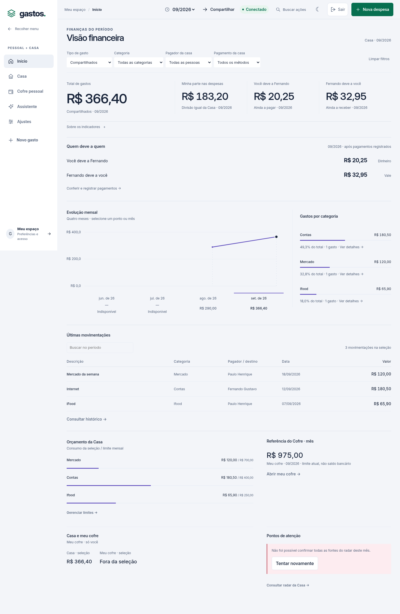
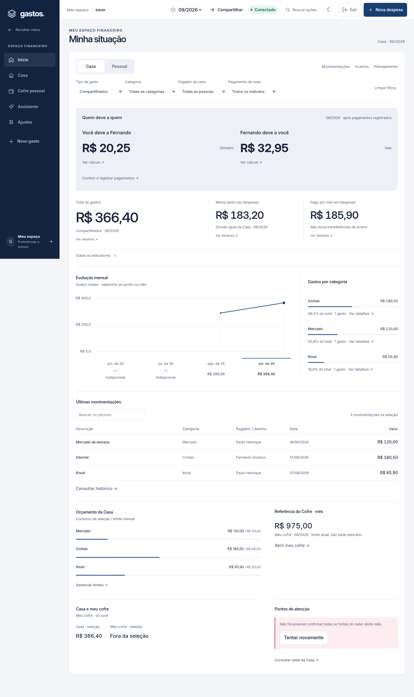
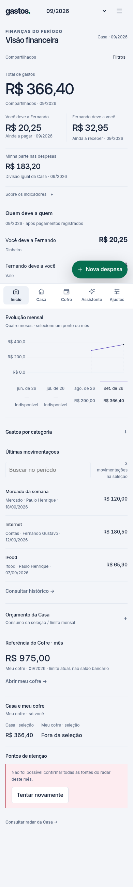
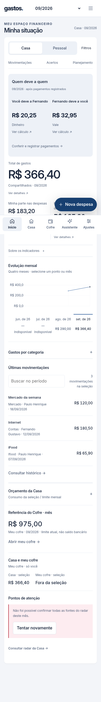
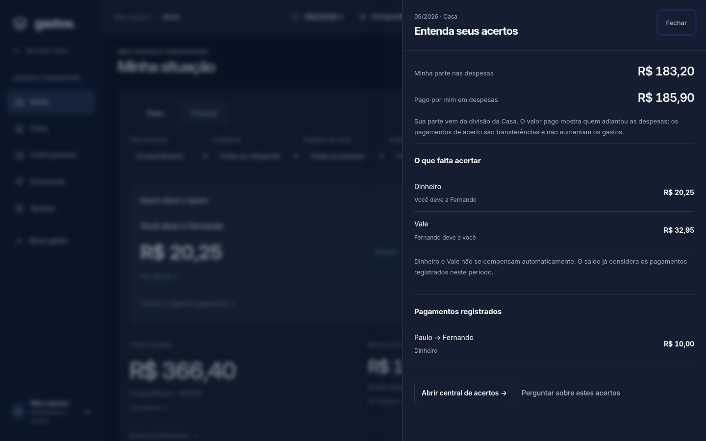

# Workspace financeiro interativo — 18/10/2026

## Problema e direção

O resumo anterior colocava os dados em uma composição aberta, repetia os saldos entre a faixa de métricas e a seção de acertos e não permitia inspecionar os indicadores. O usuário pediu áreas mais definidas e interações que conduzam da informação à ação.

A mudança reutiliza o shell React e os módulos existentes: uma superfície de trabalho delimitada, navegação azul-marinho, contexto Casa/Pessoal explícito, atalhos e inspector de leitura. Não troca o backend, os contratos, as rotas ou as regras de divisão. Não adiciona dependências.

## Implementação

- `WorkspaceToolbar`: Casa e Pessoal atualizam o mesmo store de filtros; a troca limpa filtros incompatíveis. Movimentações, Acertos e Planejamento usam a navegação existente. Comparação Casa + cofre continua disponível nos filtros.
- `BalanceSummary`: resumo principal separa a pagar e a receber, sem compensar Dinheiro/Vale. Os valores vêm do núcleo existente em centavos; o detalhamento mostra cada método. Os IDs financeiros e estados indisponíveis são preservados.
- `DashboardMetrics` / `MetricCard`: total, responsabilidade e valor pago em despesas, sem repetir os saldos do resumo. Indicadores compatíveis abrem uma consulta; não realizam operações financeiras. No contexto pessoal, a referência mensal do Cofre é distinta do total gasto.
- `DetailPanel`: dialog nativo lateral em desktop e bottom sheet em mobile. Reutiliza o gerenciador de modais, viewport, foco, bloqueio de rolagem e Escape. Fecha ao navegar ou invalidar período/filtros/fontes, evitando um painel com valores antigos. Mudanças de fontes pessoais irrelevantes não fecham uma consulta da Casa.
- `OverviewDetails`: explica responsabilidade versus valor pago, lista transferências e saldos por método ou uma prévia das movimentações filtradas. Usa os dados autorizados já disponíveis. Transferências não entram no total de despesas.
- Assistente: o painel prepara uma pergunta sobre os acertos no contexto Casa e no mês correto, sem enviar automaticamente. O fluxo existente do Cofre continua disponível. Um rascunho diferente exige confirmação antes de ser substituído; navegação, sessão e requisições posteriores invalidam a confirmação anterior.
- Superfícies coerentes no Cofre, Casa, ajustes e chat; preferência claro/escuro e cabeçalho móvel compacto mantidos. Categorias continuam abrindo drill-down e o gráfico mensal mantém seleção real do período.
- Assets `20261018-001`, cache fonte `v82`; política de cache não passa a armazenar respostas financeiras.

## Validação

Dez cenários novos de navegador verificam leitura dos acertos sem gravações, métodos separados, foco/retorno/Escape e limites em 320/390/1440 px, fechamento em falha de outro mês, troca de contexto, filtros, histórico, referência privada e encaminhamento ao chat sem apagar rascunho.

As expectativas de apresentação existentes foram atualizadas para três indicadores sem repetição, superfícies de 10/12 px e ação azul no teste offline. As verificações de valores, privacidade, erros, cache, navegação, edição, scanner e acessibilidade são preservadas. A primeira suíte integral revelou essas expectativas antigas; não foram tratadas como aprovação. Resultado final: lint/TypeScript/build e 228 unitários aprovados; suíte integral com 188 cenários Chromium aprovada. Após a correção semântica de `
` dentro dos botões para ``, 46 cenários afetados revalidados e aprovados. CI do commit 3968f70 aprovada com 228 unitários, 188 cenários e 12 grupos PostgreSQL. Evidência em `validation/INTERACTIVE-WORKSPACE-20261018.json`; a CI do PR acompanha os commits posteriores.

Comparação local com os mesmos fixtures sintéticos: 60 capturas antes/depois, cinco áreas, três larguras e dois temas. Nas 30 combinações posteriores: zero overflow horizontal e zero erro JavaScript de página. As capturas selecionadas abaixo não representam valores de produção.

| Desktop anterior | Desktop novo |
| --- | --- |
|  |  |

| Mobile anterior | Mobile novo |
| --- | --- |
|  |  |

| Inspector desktop | Inspector mobile |
| --- | --- |
|  |  |

## Entrega e limites

Branch `feature/interactive-finance-workspace`, PR #19. Prévia utiliza o pipeline isolado existente. Nenhuma publicação em produção nesta rodada; main permanece no release anteriormente aprovado. Backend, credenciais, migrações e registros históricos não foram alterados.

Validação visual/funcional com Chromium e dados sintéticos; Safari/iPhone físico e chamadas reais a Gemini/DeepSeek não exercitados. Os totais e acertos continuam sujeitos à disponibilidade e confirmação de integridade das fontes existentes. Esta rodada não modifica parcelamento, regras de recorrência, persistência de tentativas após reload nem regras financeiras do servidor.
