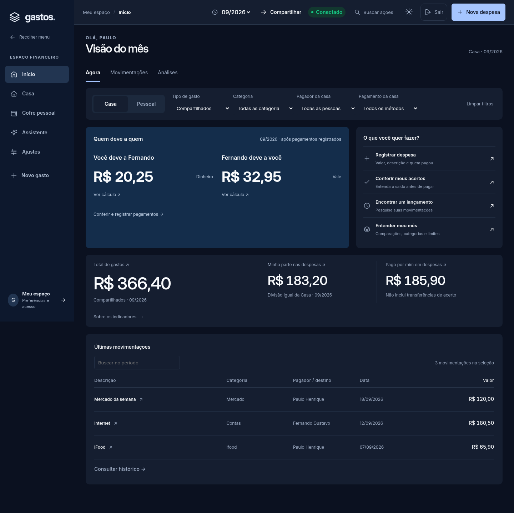

# Início orientado a tarefas — 18/10/2026

## Evidência e decisão

O usuário rejeitou a primeira prévia: o início continuava sendo um relatório longo, com todas as análises disputando atenção. A composição mudou, preservando a arquitetura React/controller e os contratos financeiros.

- **Agora:** situação de acertos em destaque, indicadores, próximas ações e cinco movimentações recentes.
- **Movimentações:** busca centralizada, consulta de cada lançamento e paginação de 25 itens, sem limitar o acesso ao restante da seleção.
- **Análises:** gráficos existentes, categorias, comparação e orçamento; acesso explícito, sem empilhar tudo no início.
- Consulta de despesa em drawer/bottom sheet reutiliza o gerenciador de modais. Pode preparar uma pergunta contextual no assistente para despesa compartilhada válida; nunca envia automaticamente nem registra uma operação financeira.
- Mobile: ação principal em fluxo na página inicial. A captura intermediária revelou que o botão flutuante cobria um valor; agora o botão ocupa uma linha antes dos saldos. Nas outras áreas o comportamento existente foi preservado.

## Implementação

Novos componentes: WorkspaceSections, ActionRail, ExpenseInspector, DashboardActivity e DashboardAnalytics. Novo hook useAppView reutiliza o estado de navegação existente, sem segunda fonte de rotas. Overview coordena as seções e invalida inspectores quando a fonte/filtro muda. TransactionList mantém o contrato padrão e aceita paginação/inspeção. DashboardPanels foi dividido para evitar crescimento do componente.

Arquivos principais: src/features/overview/Overview.tsx; componentes da mesma feature; src/app/AppShell.tsx; src/app/useAppView.ts; src/shared/ui/MetricCard.tsx; css/dashboard.css; css/workspace.css. Assets/cache atualizados em index.html e sw.js. Testes de apresentação existentes ajustados para acessar Análises antes de interagir com gráficos; asserções financeiras preservadas.

## Comparação reproduzível

Capturas com dados sintéticos dos testes, nunca contas de produção. Foram comparadas três larguras (320/390/1440), dois temas e cinco áreas, com duas novas seções no início: 30 capturas anteriores e 42 atuais, total 72. As 42 atuais não apresentaram overflow horizontal nem erro JavaScript.

Na mesma fixture clara, a altura do início passou de 2698 para 1822px em 390px (32,5% menor), e de 2424 para 1436px no desktop (40,8% menor). A redução resulta da separação de tarefas e análise; os gráficos continuam acessíveis. Não é uma medida de usabilidade com pessoas reais.

## Validação

Lint, TypeScript e build aprovados. Os 228 testes unitários e os 196 cenários Chromium passaram na validação local final do código 21c7ff9; navegador integral repetido com quatro workers. Evidência em AI-PROGRESS.md e validation/OPERATIONAL-HOME-20261018.json. Oito novos cenários cobrem navegação por teclado nas duas larguras do início, 61 registros paginados com reset pela busca, consulta sem escrita, valor inválido e ação mobile sem sobreposição em três larguras. A primeira execução integral detectou dois testes que ainda procuravam gráficos no início; foram ajustados para abrir Análises, preservando suas verificações de navegação e área de toque. A execução seguinte revelou dois seletores presos à classe antiga do botão flutuante; passaram a localizar a ação atual, mantendo contraste, tamanho mínimo, abertura e retorno de foco. Os dois cenários corrigidos passaram na revalidação direcionada antes da repetição integral.

## Limites

Nenhuma alteração de backend, banco, dados históricos, credenciais ou cálculo. Sem novas dependências. Sem deploy de produção; revisão no PR #19. Safari/iPhone físico e provedores reais de IA não foram testados nesta rodada. A prévia pode usar dados reais somente quando o usuário entra em sua conta autorizada; as imagens documentadas usam mocks.
