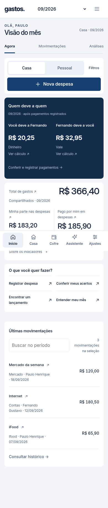
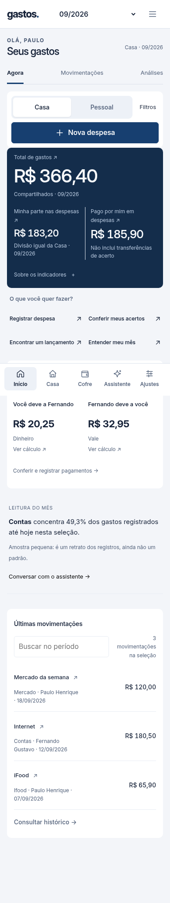
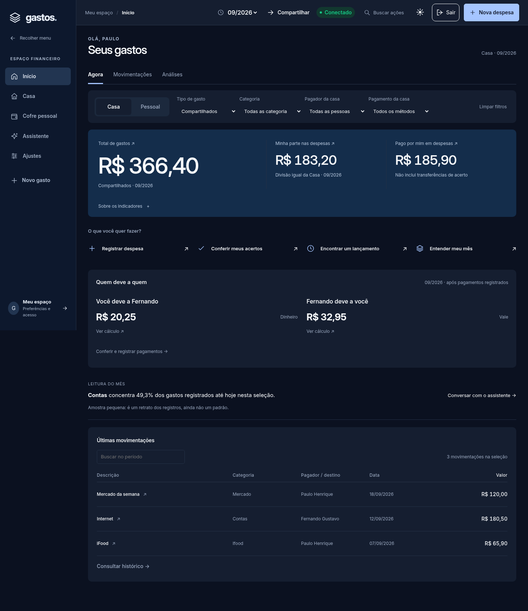

# Gastos em primeiro lugar — 18/10/2026

## Diagnóstico baseado no código e na infraestrutura

- `BalanceSummary` apresentava o mesmo texto para falha de transporte, lista sem confirmação de integridade e capacidade financeira ausente.
- `settlements.unavailable()` mostrava erro no resumo da Casa e novamente em `data-module-error=acertos`; `app.js` acrescentava banner e toast geral. Uma falha secundária gerava várias mensagens.
- O início dava protagonismo à dívida; o usuário pediu uma experiência de app orientada a gastos, inspirada na facilidade de uso do Nubank, com identidade própria.
- A prévia do PR aponta para `br-rough-cloud-a51w4e10`: `/health` respondeu 200/versão **2026-09-19.10**. Produção respondeu 200/**2026-10-17.3**. Isso comprova desatualização do ambiente, mas não comprova a causa de toda falha autenticada do usuário. Não foi utilizada sua sessão para consultar pagamentos.

## Implementação

- Total gasto e participação aparecem antes dos acertos, em superfície azul-marinho com hierarquia tipográfica. Atalhos compactos, acertos secundários, navegação e tema preservados. Não copia roxo do Nubank.
- Estado de acertos diferencia conexão indisponível, integridade incompleta, serviço que exige atualização, filtros incompatíveis e cálculo recusado. Nenhum desses estados apresenta zero ou quitação.
- HTTP 404/501 na rota é sinalizado como serviço sem suporte, sem convidar a repetir indefinidamente uma consulta de rede. Demais erros preservam retry.
- Casa tem um único aviso com retry no resumo de acertos. Removidos banner e toast duplicados para a mesma falha; outros módulos mantêm mensagens próprias e ações de recuperação. Status geral de atenção continua existindo.
- Leitura do mês usa a seleção autorizada e os mesmos filtros; avisa quando a amostra é pequena. Conversa permanece acessível pelo assistente existente.
- Motor `expense-intelligence.mjs`, sem nova biblioteca: concentração, observações acima de três vezes a mediana de ao menos cinco pares da categoria e candidatos a recorrência (três meses consecutivos, um registro por mês, variação de até 10%, janela de seis dias). São evidências descritivas, não fraude, causalidade, previsão garantida ou criação automática.
- Backend prepara essas evidências para Gemini/DeepSeek. Não há chamada real ao provedor nesta validação. A ativação no chat hospedado depende de publicar o backend correspondente em ambiente isolado validado; não foi publicado nesta rodada.

## Integração futura

Plano implementável e critérios de aceite em [PAYMENT-AUTOMATION-ROADMAP.md](PAYMENT-AUTOMATION-ROADMAP.md). PWA não lê notificações de outros bancos. Fontes bancárias exigem integração autorizada, eventos idempotentes, caixa privada de revisão, conciliação e regra explícita para transferências/estornos/faturas.

## Ambiente de ensaio e limite encontrado

Foi criado o clone exploratório `br-curly-brook-a5ce5kjw`, no projeto da Function, para verificar herança do backend atualizado. Sua única base era `api_backend`, não a base financeira esperada; o ambiente de validação anterior `br-dry-sea-ac9sj8ie` não está disponível nesse projeto. Isolamento dos destinos Auth/Data API da Function herdada não foi comprovado. Por isso a Function clonada foi removida e seu compute `ep-purple-math-a52uai1d` suspenso, sem conectar o frontend nem fazer requisições de escrita. Não foram alteradas chaves, configurações, funções ou bases de produção. A branch exploratória sem Function permanece como rastreio do ensaio, sem migração ou conexão bancária.

O workflow continua apontando para o backend antigo, para não redirecionar a prévia ao banco real ou prometer isolamento inexistente. Atualizar essa infraestrutura é pendência explícita; a nova interface informa limitações em vez de apresentar valores de acertos inventados. Health público não substitui ensaio autenticado Auth/JWT/RLS.

## Validação e evidência

Resultados finais: lint/TypeScript/build aprovados; 236 unitários e 203 cenários Chromium aprovados localmente. CI exata do código 1e99294 aprovada com os mesmos testes e 12 grupos PostgreSQL. Oito unitários e sete cenários novos. Uma rodada intermediária foi invalidada por recriação concorrente de dist durante testes com reload; a suíte inteira foi repetida com build estável e passou. Comparação de 84 capturas, 42 combinações finais sem overflow horizontal/erro JavaScript. Evidência em AI-PROGRESS.md e validation/SPENDING-FIRST-20261018.json. Novos testes verificam estados distintos, falha sem avisos duplicados, retry, preservação dos gastos, prioridade visual, filtros, precisão monetária, amostra pequena, recorrência, anomalia e privacidade do contexto do cofre. Capturas usam fixtures sintéticas, nunca dados apresentados como reais.

Safari físico, integração bancária e provedores reais continuam fora da validação desta rodada. Nenhum deploy de produção, migração ou reescrita de histórico.

## Capturas da mesma fixture sintética

| Antes mobile | Depois mobile |
| --- | --- |
|  |  |

